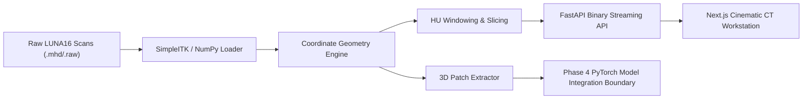

# LungAI Architecture Specification (Phases 1–3)

## 1. System Overview

**LungAI** is an AI pulmonary CT imaging workstation and research platform designed for reproducible nodule detection and evaluation against the LUNA16 benchmark.



## 2. Component Boundaries

### 2.1 Backend (`services/api/`)
- **`app/core/config.py`**: Pydantic settings loading environment variables with fallback defaults.
- **`app/imaging/coordinates.py`**: Encapsulates 3D coordinate conversions between physical world coordinates (mm), continuous voxel indices, integer voxel indices, and NumPy array ordering.
- **`app/imaging/loader.py`**: `CTVolume` container handling `.mhd`/`.raw` loading, metadata extraction (origin, spacing, direction matrix), and orthogonal slicing (axial, coronal, sagittal).
- **`app/imaging/windowing.py`**: Clinical Hounsfield Unit (HU) window/level presets (Lung: -600/1500 HU, Mediastinum: 40/400 HU, Bone: 300/1500 HU, Nodule: -500/1000 HU) and deep-learning HU input normalization (-1000 to +400 HU).
- **`app/imaging/patch_extractor.py`**: Extracts centered 3D patches with boundary detection and constant air padding (-1000 HU) for edge candidates.
- **`app/services/volume_service.py`**: Active CT volume cache, scan registry, and candidate association.
- **`app/api/routes.py`**: REST and binary slice streaming endpoints.

### 2.2 Machine Learning Infrastructure (`ml/`)
- **`data/luna16_parser.py`**: Robust parser and validator for `annotations.csv` and `candidates.csv`, filtering malformed rows and rejecting non-positive diameters.
- **`data/manifest.py`**: Automatic dataset discovery, metadata indexing, and scan-level train/validation/test splitting with guaranteed zero leakage across splits.
- **`data/synthetic.py` & `scripts/generate_synthetic_scan.py`**: Verifiable synthetic scan generator for continuous testing without downloading full 50GB LUNA16.

### 2.3 Frontend Workstation (`apps/web/`)
- **Tech Stack**: Next.js 16 (App Router), React 19, TypeScript strict mode, Tailwind CSS.
- **Components**:
  - `CTViewer`: Interactive HTML5 canvas CT viewer supporting pan, zoom, slice scrolling, multiplanar views (axial/coronal/sagittal), and candidate overlays.
  - `SliceSlider`: Slider with Cine loop playback and keyboard navigation.
  - `CandidatePanel`: Candidate list with ground-truth/model status, physical coords, and slice location.
  - `NoduleMagnifier`: 4x magnified crop centered around selected nodule.
  - `WorkflowStatus`: Real-time phase tracking without fabricating unverified metrics.
  - `AnalyticsPanel`: FROC and CPM benchmark dashboard displaying honest pending states.
  - `DatasetLab`: Visual dataset readiness indicator.

## 3. Coordinate Convention & Orientation Protocol

SimpleITK uses `(X, Y, Z)` in millimeter space:
- $X$: Left/Right
- $Y$: Anterior/Posterior
- $Z$: Inferior/Superior

When converted to NumPy via `sitk.GetArrayFromImage()`, the index order becomes `(Z, Y, X)` (i.e., slice, row, column).

LungAI enforces:
```python
numpy_array[slice_idx, row_idx, col_idx] == sitk_image[x, y, z]
```
where $x = \text{col\_idx}$, $y = \text{row\_idx}$, $z = \text{slice\_idx}$. All coordinate calculations explicitly pass through `services/api/app/imaging/coordinates.py`.

## 4. Phase 4 Model Integration Roadmap

The Phase 4 deep-learning pipeline hooks directly into:
1. `ml/candidates/`: Uses `extract_candidate_patch()` to generate 3D tensors $(C, D, H, W)$ for candidate classification.
2. `ml/models/`: PyTorch 3D CNN / 3D ResNet / UNet backbone.
3. `services/api/app/schemas/imaging.py`: Sets `CandidateItem.model_score` from real PyTorch inference.
