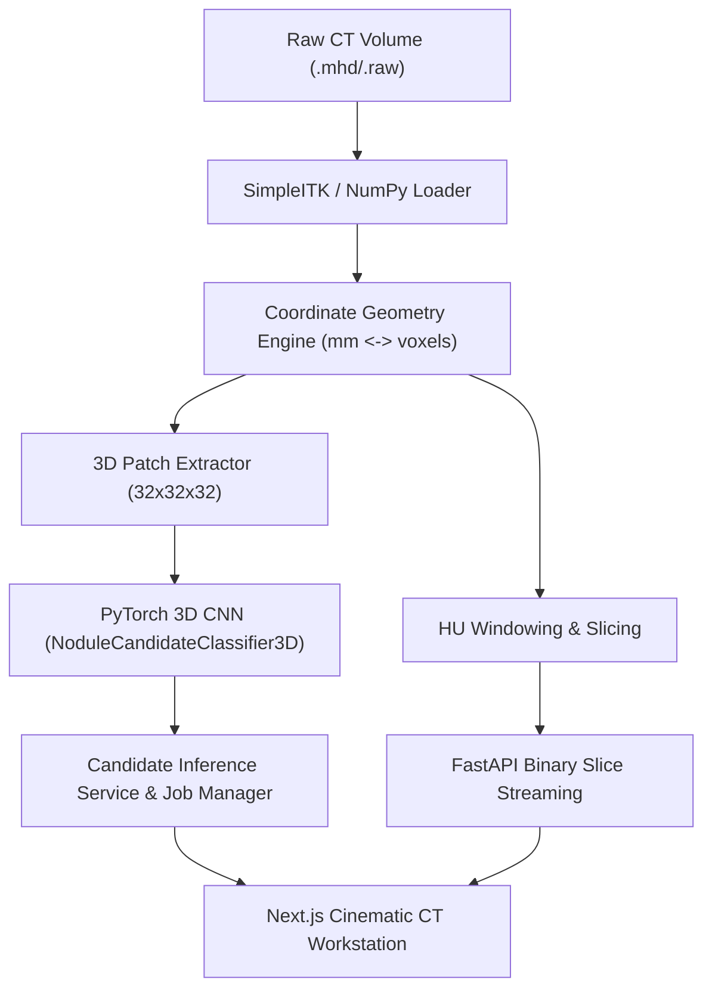

# LungAI Architecture Specification (Phases 1–6)

## 1. System Overview

**LungAI** is an AI pulmonary CT imaging workstation and research platform designed for reproducible nodule candidate classification and real CT visualization based on the LUNA16 benchmark.

## 2. Component Boundaries

### 2.1 PyTorch Candidate Classifier (`ml/`)
- **`ml/models/classifier3d.py`**: Compact 3D CNN (`NoduleCandidateClassifier3D`) accepting $32 \times 32 \times 32$ CT patches. Uses LeakyReLU, BatchNorm3d, 3D MaxPool, and global spatial pooling, outputting raw binary classification logits.
- **`ml/candidates/dataset.py`**: PyTorch `CandidatePatchDataset` sampling centered 3D subvolumes, with constant air padding ($-1000$ HU) near volume edges and intensity normalization ($[-1000, +400]$ HU $\to [0.0, 1.0]$ float32).
- **`ml/training/train.py`**: Full training pipeline with scan-level split enforcement (zero scan leakage), class-imbalanced weighted BCE loss, and versioned checkpoint serialization outside Git (`checkpoints/best_candidate_classifier.pt`).
- **`ml/evaluation/metrics.py`**: Evaluation module computing accuracy, precision, recall, F1, confusion matrix, ROC-AUC, and threshold sweeps.

### 2.2 Inference Service & Job Manager (`services/api/`)
- **`services/api/app/services/model_service.py`**: Dedicated singleton service loading checkpoints once during lifecycle, running evaluation inference, and measuring device latency without hardcoding.
- **`services/api/app/services/job_manager.py`**: Bounded in-process asynchronous task manager (`ThreadPoolExecutor`) preventing GPU/CPU overload and providing progress tracking.
- **`services/api/app/api/routes.py`**:
  - `GET /api/imaging/model`: Returns architecture, patch dimensions, and status.
  - `GET /api/imaging/model/latency`: Profiles server latency.
  - `POST /api/imaging/scans/{scan_id}/infer`: Initiates candidate scoring.
  - `GET /api/imaging/jobs/{job_id}`: Polls async inference progress.
  - `GET /api/imaging/scans/{scan_id}/candidates`: Returns scored candidate predictions.

### 2.3 Frontend Workstation (`apps/web/`)
- **`components/viewer/CTViewer.tsx`**: Multiplanar canvas viewer (axial, coronal, sagittal) rendering candidate crosshairs, highlighted selections, and score threshold filters.
- **`components/candidates/CandidatePanel.tsx`**: Candidate selector triggering live model inference, filtering by confidence score, and updating candidate markers.
- **`components/candidates/NoduleMagnifier.tsx`**: 4x magnified crop centered around selected nodule candidate with crosshairs and model probability.
- **`components/analytics/AnalyticsPanel.tsx`**: Displays live model metadata, checkpoint validation metrics, and server latency telemetry.

## 3. Scope Distinction: Candidate Classification vs Autonomous Detection

LungAI clearly distinguishes between:
1. **Candidate Classification (Implemented in Phase 4–6):** Given candidate proposals (from LUNA16 annotations or candidate generators), the model evaluates and outputs a confidence score for each location.
2. **Whole-Volume Detection (Future Phase):** Autonomous sliding-window or 3D anchor-based proposal generation across entire unseeded lung volumes.
