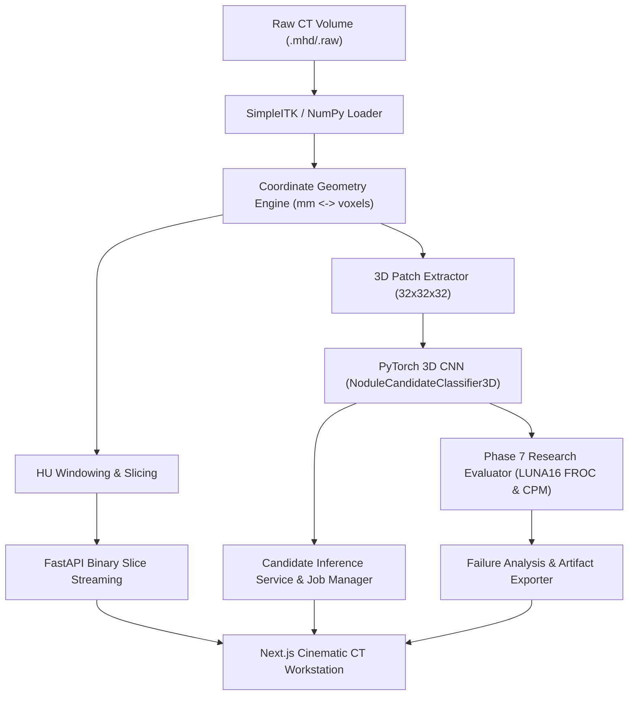

# LungAI Architecture Specification (Phases 1–7)

## 1. System Overview

**LungAI** is an AI pulmonary CT imaging workstation and research platform designed for reproducible nodule candidate classification, real CT visualization, and research-grade evaluation based on the official LUNA16 benchmark.

## 2. Component Boundaries

### 2.1 Research Evaluation Framework (`ml/evaluation/`)
- **`ml/evaluation/froc.py`**:
  - Implements the official LUNA16 Free-Response ROC (FROC) matching protocol.
  - Computes Euclidean distance $d \le \text{radius\_mm}$ between physical coordinates $(x, y, z)$ of prediction and ground truth.
  - Duplicate rule: Multiple hits to the same reference nodule count as 1 True Positive (highest confidence score); subsequent hits are marked as duplicates and do not pollute False Positive counts.
  - Aggregates sensitivity at 7 official operating points: $[0.125, 0.25, 0.5, 1.0, 2.0, 4.0, 8.0]$ False Positives per scan.
  - Computes the Competition Performance Metric (CPM) as the mean sensitivity across the 7 operating points.
- **`ml/evaluation/failure_analysis.py`**:
  - Categorizes False Positives (high-confidence $\ge 0.75$ vs borderline).
  - Categorizes False Negatives (missed reference nodules).
  - Stratifies sensitivity across nodule diameter bins: Small ($<5$ mm), Medium ($5$–$10$ mm), Large ($\ge 10$ mm).
  - Generates machine-readable JSON and human-readable clinical Markdown reports.
- **`ml/evaluation/evaluate.py`**:
  - Reproducible CLI runner evaluating locked test splits and writing versioned artifacts to `artifacts/evaluation/`.

### 2.2 Inference Service & Job Manager (`services/api/`)
- **`services/api/app/services/evaluation_service.py`**: Reads persisted evaluation summaries and reports without running redundant heavy re-computations.
- **`services/api/app/api/routes.py`**:
  - `GET /api/imaging/evaluation`: Returns structured FROC, classification metrics, and failure analysis.
  - `GET /api/imaging/evaluation/report`: Returns downloadable Markdown clinical report.
  - `GET /api/imaging/evaluation/download/candidates`: Exports scored candidates in CSV format.

### 2.3 Research Visual Analytics (`apps/web/`)
- **`components/analytics/AnalyticsPanel.tsx`**:
  - Interactive SVG plot of the LUNA16 FROC curve displaying sensitivities across FP/scan points.
  - Real-time confusion matrix and threshold sensitivity sweep table.
  - Clinical failure analysis with diameter stratification.
  - Per-scan evaluation metrics table.
  - Downloadable CSV and Markdown report exports.

## 3. Strict Protocol Distinction

- **Candidate Classification:** Evaluates candidate proposal locations.
- **Whole-Volume Detection:** Autonomous scanning across entire unseeded lung volumes.
- All evaluation reports clearly document this distinction.
